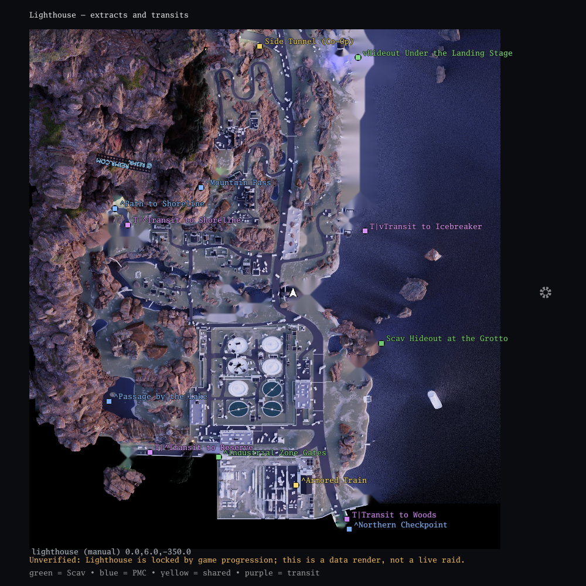
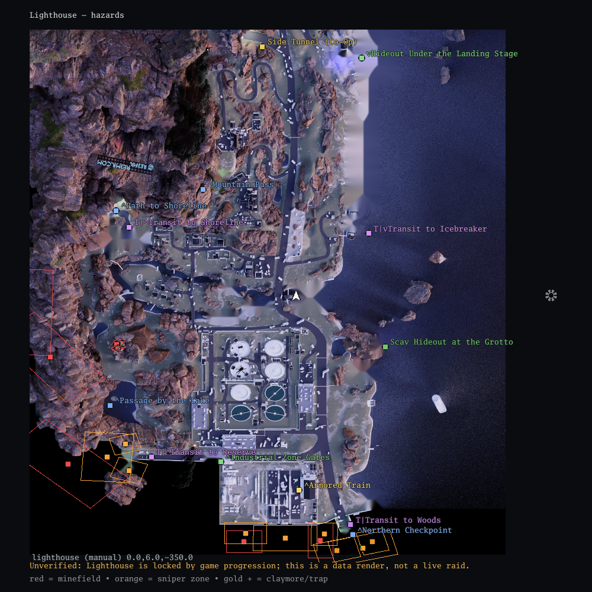
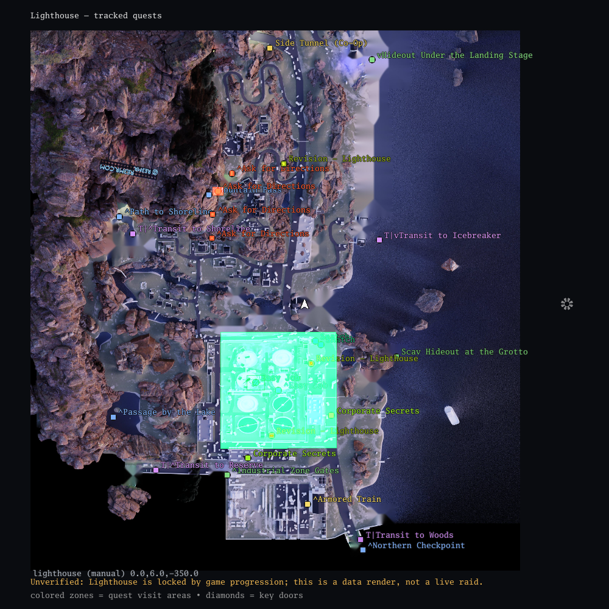
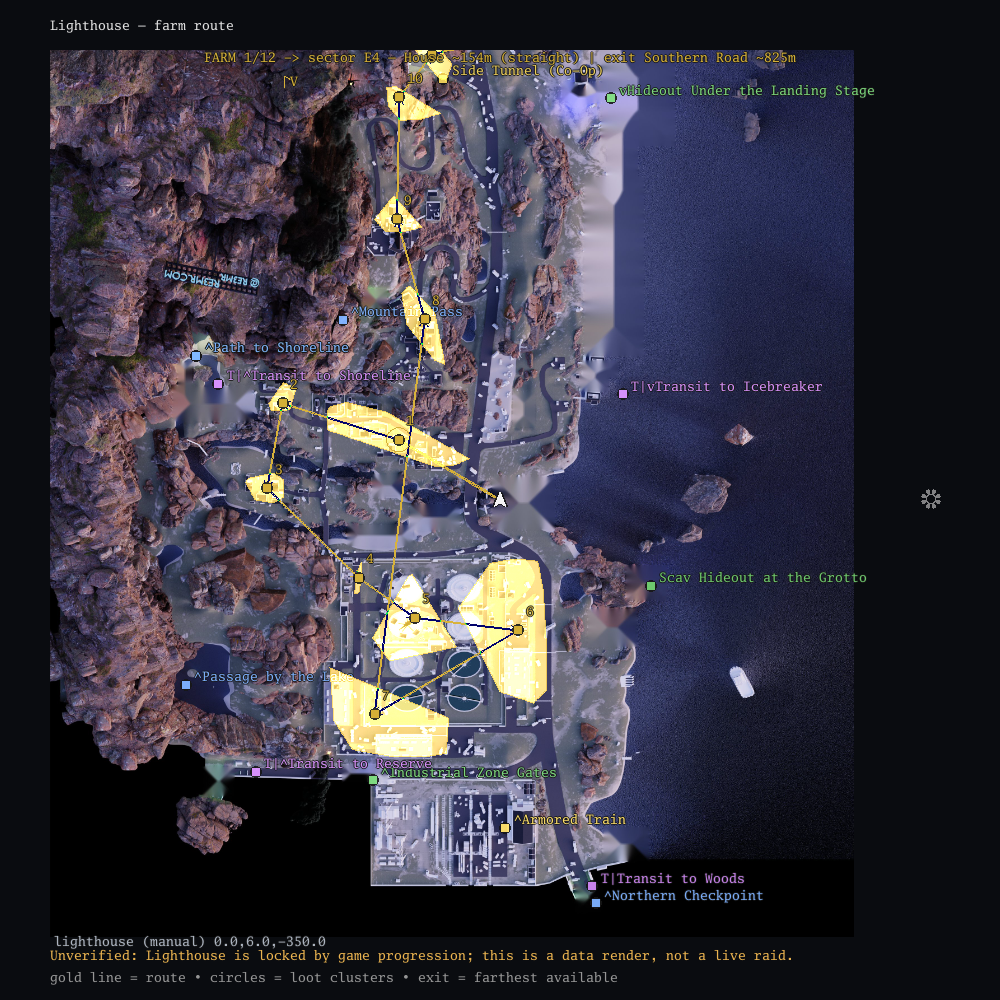
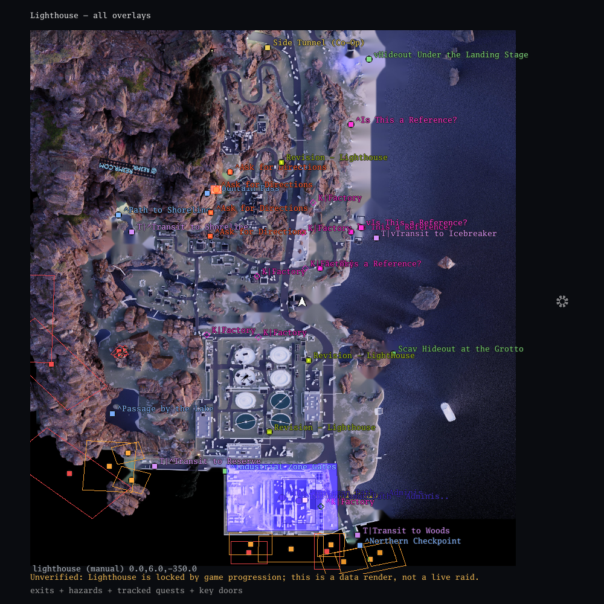

# TarkyMappy

**A transparent, click-through minimap overlay for Escape from Tarkov.**
Offline-first. Windows 10/11. Go + Ebitengine.

[](https://go.dev/)
[](#requirements)
[](https://ebitengine.org/)
[](#privacy-and-safety)
[](LICENSE)
[](#build-from-source)

[Русская инструкция](HOWTOUSE_RU.md) · [English guide](HOWTOUSE_EN.md) · [FAQ](FAQ.md) · [Updating data](UPDATING.md) · [Tags](TAGS.txt)

---

> ## ⚠️ First screenshot is required
>
> TarkyMappy has no player position until it sees a screenshot. **Enter a raid,
> press `PrtSc` once, and the overlay will center on you.** If the screenshots
> folder is non-standard, set it in `F9` → **Browse…** → **Apply**.
>
> This is the most common “it does not work” case: the app is running, but no
> screenshot has been taken yet.

---

## What it is

TarkyMappy is a small always-on-top, click-through window that turns your
in-game screenshots into a live minimap. It reads the position and view
direction from the screenshot **file name**, detects the map, and draws:

- the map around you, rotated so your view is up;
- PMC / Scav / shared extracts and transits;
- minefields, sniper zones, claymores and traps;
- tracked quests, visit zones, objectives, keys and key doors;
- loot clusters and a farm route with exit selection;
- flea market prices by price-per-slot (PvP / PvE).

No game memory access, no injection, no network traffic during normal play.

## Features

| | |
|---|---|
| 🗺️ **10 maps, multi-floor** | Customs, Factory, Ground Zero, Interchange, Labs, Lighthouse, Reserve, Shoreline, Streets of Tarkov, Woods. |
| 🎯 **Auto map detect** | Based on the player's `X,Z` and map bounds; manual pick and `F10` cycle as fallback. |
| 🚪 **Extracts and transits** | Faction colors, floor arrows, transit labels. |
| ☠️ **Hazards** | Minefields, sniper zones, claymores/traps, with zone outlines. |
| 📜 **Quest Helper** | Tracks quests manually or from EFT push logs, shows objectives, keys, doors and wiki links. |
| 💰 **Farm Helper** | Clusters loot, builds a route from your position, picks the farthest exit. |
| 💵 **Price Helper** | Top flea market items by ₽/slot, PvP and PvE, updatable without rebuilding. |
| 🌐 **RU / EN UI** | Russian by default; switch in `F9`. Game data is localized from `loc_ru.json`. |
| 🪶 **Low idle load** | 30 logic TPS, dirty-frame rendering, throttling when idle. |
| 🔒 **Offline runtime** | All map/quest/loot/hazard data is embedded in the exe. Only the price updater uses the network. |

## Lighthouse preview

> **Lighthouse has NOT been verified in a live raid.**
> The map is still locked for the author's account because of game progression,
> so it could not be tested in an actual Lighthouse raid. The images below are
> rendered by the app from the embedded data, not captured from gameplay.
> Treat Lighthouse geometry, labels, quests, hazards and extracts as
> **unverified until checked in-game after the map is unlocked**.

These images are generated from the same embedded data the overlay uses. They
show the Lighthouse map with different marker sets — useful for checking the
map while it is still locked in-game.

| Extracts and transits | Hazards |
|---|---|
|  |  |
| **Tracked quests** | **Farm route** |
|  |  |

**All overlays together: exits + hazards + quests + key doors**



> The previews are rendered by the `preview` build-tag test:
> `go test -tags preview -run TestGenerateLighthousePreviews -v`.
> They are not gameplay screenshots and contain no personal data.

## Hotkeys

| Key | Action |
|---|---|
| `F2` | Prices panel (PvP / PvE, top ₽/slot) |
| `F3` | Farm Helper panel and route |
| `F4` | Quest Helper panel |
| `F5` / `F6` | Zoom in / out |
| `F7` | Hide / show overlay |
| `F8` | Quit |
| `F9` | Settings |
| `F10` | Next map (manual pick) |
| `PageUp` / `PageDown` | Floor up / down |
| `?` in F9 | FAQ panel |

Panels temporarily disable click-through; closing them restores it. The window
can be dragged by the top bar and resized by the bottom-right grip.

## Quick start

1. Download the release and keep `TarkyMappy.exe` next to the `prices` folder.
2. Run the exe.
3. Enter a raid and press **`PrtSc`** once.
4. The overlay centers on your position. If not, open `F9` and set the
   screenshots folder.
5. Use the hotkeys above. `F8` quits.

Expected folder layout:

```
TarkyMappy.exe
prices\
  prices.json
  update_prices.py
README_FIRST_RU.txt
README_FIRST_EN.txt
```

## Requirements

- Windows 10/11 (64-bit).
- Escape from Tarkov in **Borderless** or **Windowed** mode.
- EFT screenshots folder:
  `%USERPROFILE%\Documents\Escape from Tarkov\Screenshots`
  (OneDrive redirection is detected automatically).
- Optional: Python 3.8+ for price updates.
- Optional: Go 1.27+ for building from source.

## Build from source

### Interactive helpers

Two batch helpers do everything: check the tree, check Go, run tests and
`go vet`, build `dist\TarkyMappy.exe`, copy `prices\` and docs, and offer a ZIP.

```powershell
build_ru.bat
build_en.bat
```

Non-interactive smoke run:

```powershell
build_en.bat /auto
build_ru.bat /auto
```

### Manual build

```powershell
go mod download
go test ./...
go vet ./...
go build -trimpath -ldflags="-s -w -H=windowsgui" -o dist\TarkyMappy.exe .
```

Copy `prices\` next to the exe. The executable icon is embedded via
`rsrc_windows_amd64.syso`; `icon64.png` is required by `go:embed`.

### Developer data tools

- `tools/update_data.ps1` — rebuild `data/exits.json`, `quests.json`,
  `locks.json`, `farm.json`, `hazards.json`, `loc_ru.json` from local
  `json.tarkov.dev` snapshots.
- `tools/make_maps.ps1` — rasterize `TarkovTracker/tarkovdata` SVG maps into
  per-floor PNGs. Pass `-Magick <path>` if `magick.exe` is not in `PATH`.
- `tools/genicon.go` — regenerate `app.ico` and `icon64.png`.
- `preview_lighthouse_test.go` — regenerate the preview images above.

More details: [UPDATING.md](UPDATING.md).

## How it works

EFT writes screenshots with a name like:

```
2026-08-30[17-30]_388.36, 2.64, -114.48_0.00027, 0.98771, -0.00171, 0.15626_8.60 (0).png
```

The overlay parses the file name only:

- `X, Y, Z` — player position (Unity coordinates);
- quaternion — yaw (`RotY`);
- `X,Z` → map bounds → map key;
- `Y` → floor.

Rendering uses `u=(x−b₀ₓ)/(b₁ₓ−b₀ₓ)`, `v=(z−b₀ᵧ)/(b₁ᵧ−b₀ᵧ)` from the
TarkovTracker map viewer, then rotates the map so the view direction is up.
The screenshot image itself is never read.

## Data and sources

- Map artwork: [TarkovTracker/tarkovdata](https://github.com/TarkovTracker/tarkovdata),
  CC BY-NC-SA 4.0.
- Lighthouse artwork: reemr / re3mr.com, Lighthouse v1.7, CC BY-NC-SA 4.0.
- Exits, transits, quests, traders, items, loot, locks, hazards: snapshots of
  `json.tarkov.dev` / `tarkov.dev`.
- Snapshot metadata: `data/meta.json` (game build and date).
- Full attributions: [THIRD_PARTY_NOTICES.md](THIRD_PARTY_NOTICES.md).

## Privacy and safety

- Runtime is offline: no telemetry, no network calls, no game memory access,
  no process injection, no traffic interception.
- The app reads screenshot **file names** and, if configured, EFT **text logs**.
- Screenshot content is not analyzed.
- The price updater is the only component that uses the network.
- Config: `%AppData%\TarkyMappy\config.json`; log: `tarkymappy.log` next to the
  exe.

## Known limitations

- Customs and Reserve bounds overlap; auto-detect may pick the wrong one
  without raid history. Use `F10`, manual pick, or the EFT `Logs` folder.
- Farm routes are straight lines; open data has no navmesh.
- Floors are selected by `Y`; use `PageUp` / `PageDown` when needed.
- Some underground SVG floors are nearly empty; the ground layer is drawn
  underneath at partial opacity.
- Untranslated strings fall back to English in the RU UI.
- **Lighthouse is not verified in a live raid.** It is locked for the author by
  game progression, so its map alignment, quests, hazards and extracts were
  checked only against the embedded data and preview renders.
- Data is a snapshot; after a game patch, update it with `UPDATING.md`.

## License

**Personal, non-commercial use only.** No selling, reselling, monetization,
paid services, ad-supported distribution, crypto/NFT use, or any use for which
you receive money or commercial benefit. See [LICENSE](LICENSE).

Maps and data are distributed under **CC BY-NC-SA 4.0**; see
[THIRD_PARTY_NOTICES.md](THIRD_PARTY_NOTICES.md).

TarkyMappy is an unofficial community project, not affiliated with or endorsed
by Battlestate Games. Escape from Tarkov and related marks belong to their
respective owners. Use at your own risk and follow the game rules.

---

**Documentation:** [HOWTOUSE_RU.md](HOWTOUSE_RU.md) · [HOWTOUSE_EN.md](HOWTOUSE_EN.md) · [FAQ.md](FAQ.md) · [UPDATING.md](UPDATING.md) · [TAGS.txt](TAGS.txt)
